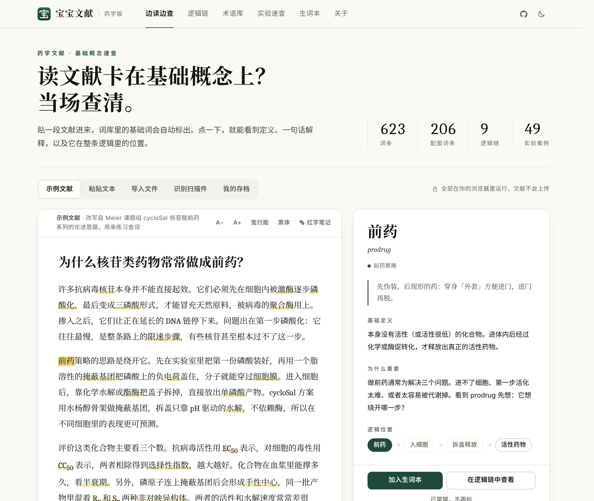

# 宝宝文献 · 药学版

**中文** | [English](README.en.md)

读药学文献时，最容易卡住的是那些作者默认你已经懂的基础概念。把读不下去的那一段贴进来，词库里收录的词会自动加上底色，点一下就能看到它的定义、一句大白话的解释，以及它在整条逻辑里处在哪一环。

它就是一个网页，不用安装，也不用注册。文献只在你自己的浏览器里处理，不会上传到任何地方。

在线版：<https://gustavpharm.github.io/babypaper/>



## 能做什么

- **边读边查**：粘贴一段文字，或者导入、拖入 `.txt`、`.md`、`.pdf` 文件；扫描版 PDF 和图片可以先做 OCR 识别。词库里有的词会自动加上底色，中文和英文文献都认得（英文里的复数、带连字符的写法也能认出来），点一下就查。没被标出来的词，划选之后同样可以查。已经会了的词标成「已掌握」，以后就不再加底色。
- **词条卡片**：每个词条先给一句大白话，然后是基础定义、它在文献里为什么重要、常见的误解、在逻辑链里的位置，最后是配图和出处。补充内容默认收起，想看再展开。
- **逻辑链**：一共 9 条，把零散的概念按因果顺序串起来，比如核苷药为什么需要前药、怎么读一张活性数据表、方法学验证看哪些关键点。链上的每一环都能点进对应的词条。
- **术语库**：623 个词条，分成 19 类，包括药物化学、药理学、药物分析、药剂学、生药学、人名反应、实验室常用药物和药学常用药物等。可以用中文、英文或缩写搜索。
- **文献存档**：导入过的文献会自动存在浏览器里，最多 12 篇。下次在「我的存档」里点开就能接着读，不用重新导入。
- **红字笔记**：打开「✎ 红字笔记」开关，点正文的任意位置就可以打字。笔记用红字插在正文里，跟存档一起保存，之后能改也能删。
- **实验速查**：49 个案例，每个都概括自一篇公开论文里的做法，列出流程、用量和主要危害，并附原文链接。它们只代表那一篇论文，不是通用的操作规程。
- **生词本**：存在浏览器本地，可以用来自测，也可以导出成 Markdown 或 Anki 卡片。

另外支持深色模式和手机屏幕，全程可以用键盘操作，按 `/` 直接搜索术语库。

## 怎么用

**在线用**：直接打开[在线版](https://gustavpharm.github.io/babypaper/)。想自己部署一份，给仓库开启 GitHub Pages 就行（Settings → Pages → Deploy from a branch → `main` / root）。

**在本地用**：下载仓库，双击 `index.html` 即可。也可以起一个本地服务器：

```bash
node tools/serve.js
```

然后打开 <http://127.0.0.1:8765>。

**打包成单个文件**：想通过微信之类的渠道转给别人，可以把整个工具打包成一个 HTML 文件：

```bash
node tools/build-single.js
```

成品是 `dist/宝宝文献.html`，约 17 MB，样式、脚本、词库和配图都在里面。

> 导入 PDF 和 OCR 识别这两步要联网：页面会从 CDN 按需加载 [pdf.js](https://mozilla.github.io/pdf.js/) 和 [Tesseract.js](https://github.com/naptha/tesseract.js)。其余功能离线可用。

## 装到手机上

有两种装法，选一种就行。

**PWA（推荐，不用下载安装包）**
安卓用 Chrome 打开[在线版](https://gustavpharm.github.io/babypaper/)，在浏览器菜单里点「安装应用」或「添加到主屏幕」；iPhone 用 Safari 打开，点分享按钮，再选「添加到主屏幕」。装好后桌面上会多一个「宝」字图标，点开是全屏的。第一次打开后词库会缓存在手机里，之后没网也能用。

**安卓 APK 安装包**
在本仓库的 [Releases](../../releases) 页下载 `babypaper-v1.0.0.apk`，传到手机上点开安装。安装包带正式签名，系统提示「未知来源」时允许一次即可。也可以自己打包：在仓库的 Actions 页找到「Build Android APK」，点 Run workflow，跑完后在那次运行记录的底部下载 `babypaper-apk`。

装成 app 之后，每次点开会有一段不到两秒的开屏动画，写出一个「宝」字再进入界面。在网页里打开时没有这一段。

## 目录结构

网页本身是纯静态的，没有依赖，也没有构建步骤。

```
index.html              页面结构与界面文案
assets/css/app.css      样式（设计变量在文件开头）
assets/js/app.js        全部交互逻辑
assets/js/en-terms.js   英文标词表的推导规则（纯函数，Node 里也能跑）
assets/figures/         词条配图（来源与许可证见 CREDITS.md）
assets/icons/           网页和 PWA 用的图标
android-icon-res/       安卓安装包用的图标和启动图
data/kb.js              词库，一行一个词条
data/chains.js          逻辑链
data/experiments.js     实验速查
tools/                  本地预览、数据自检、配图尺寸、署名清单、英文标词表、打包单文件、生成图标
docs/                   词库修订记录等文档
```

## 参与贡献

最缺的是词条内容：补充新词条、纠正定义、换上更准确的出处，或者提供可以开放使用的配图。

### 新增或修改词条

编辑 `data/kb.js`，每行是一个 JSON 对象：

```json
{"w":"词条名","en":"English name","cat":"药理学","alias":"别名一；别名二","def":"基础定义……","plain":"一句话大白话。","use":"在文献里为什么重要……","trap":"常见误解……","chain":["上游词","词条名","下游词"],"src":"定义出处……"}
```

| 字段 | 必填 | 说明 |
| --- | --- | --- |
| `w` / `en` / `cat` | 是 | 词条名、英文名、分类 |
| `def` / `plain` / `use` | 是 | 基础定义、一句话解释、在文献里为什么重要 |
| `alias` | | 别名，用全角分号 `；` 分隔；中文别名会参与自动标词 |
| `trap` | | 常见误解 |
| `extra` | | 补充小节，`[{"h":"标题","p":"正文"}]` |
| `chain` | | 逻辑位置：按因果顺序列出相邻的词，其中要包含词条自己 |
| `fig` / `figs` | | 配图 `{img, cap, credit, link}`；`img` 指向 `assets/figures/` 下的文件 |
| `figIdea` | | 暂时没有开放图片时，写「这张图应该怎么画」 |
| `src` / `srclink` | | 定义出处、在线核对链接 |
| `unverified` | | 尚未对照原文核实时，写明情况，界面会显示「待核实」 |

几条约定：

1. **定义要有出处**。按教材、规范或公开资料里的通行表述来写，不要凭印象。拿不准的就填 `unverified`。
2. **只写纯文本**。字段里不要写 HTML。正文里的 `1. …。2. …。` 会自动排成列表。
3. **配图只收开放许可的图片**（公共领域、CC0、CC BY、CC BY-SA），并在 `credit` 里写明作者和许可证。商业教科书里的插图不收。
4. **英文名决定英文文献里能不能标出来**。`en` 和英文别名会被拆成短语去匹配正文，比如 `selectivity index (SI)` 能认出 `selectivity index` 和它的复数。缩写至少要 3 个字符才认，并且区分大小写。改完可以把整张匹配表打印出来，看看有没有误标；加 `--single` 只看最容易出问题的单个词：

```bash
node tools/list-en-terms.js --single
```

   不想单独标出来的常见词（如 assay、target）和容易撞车的缩写（如 BET、PSA），加到 `assets/js/en-terms.js` 开头的停用表里。

5. 提交前跑一遍自检。增删过配图的话，再更新配图尺寸和署名清单：

```bash
node tools/check-data.js
node tools/fig-sizes.js
node tools/build-credits.js
```

### 修改界面

改 `index.html`、`assets/css/app.css`、`assets/js/app.js`，刷新页面就能看到效果。颜色、字体、圆角这些设计变量都集中在 `app.css` 开头，深色模式有对应的一组。

部署自己的一份之后，把 `assets/js/app.js` 开头的 `CONFIG.repoUrl` 填成你的仓库地址，顶栏就会出现 GitHub 入口。

图标（桌面图标、安卓自适应图标、favicon）是 `tools/build-icons.js` 画出来的，字形和配色都写在脚本开头。改完跑一遍 `node tools/build-icons.js`，全部尺寸会重新导出。

开屏动画和图标用的是同一套字形，页面里的那段标记也由这个脚本生成，动效写在 `app.css` 的「开屏动画」一节。在浏览器里给地址加上 `?splash` 就能预览。

## 内容来源与免责声明

- 词条的「基础定义」是对照教材、ICH 和药典等规范以及公开资料转写的，每条底部都注明了来源，页面里的「关于」页有汇总。「一句话」和「为什么重要」是通俗的转述。**正式引用请以教材和文献原文为准。**
- 人名反应类词条主要对照 Wikipedia 的相应条目和 LibreTexts 开放教材。
- 实验速查里的每一条只是所引那一篇论文的做法，不是通用操作规程。五个分数是编者的主观印象，没有统一的评分细则。动手之前请先读原文、查试剂的 SDS，并遵守所在实验室的安全规程。
- 部分出处引的还是旧版教材或《中国药典》2020 年版，尚未对照新版更新。
- 本项目只用于学习交流，不构成任何用药或临床建议。
- 词库分批修订和订正的记录见 [docs/词库修订记录.md](docs/词库修订记录.md)。

## 配图

`assets/figures/` 里的图片来自 PubChem（公共领域）以及 Wikimedia Commons 和 OpenStax（公共领域、CC0、CC BY、CC BY-SA），版权归原作者所有。每张图的作者、许可证和原图链接见 [CREDITS.md](CREDITS.md)。

## 致谢

界面的版式和交互思路参考了默读 Modureader、Yomitan、Skola、Elementro、Avogadro 等开源项目，只借鉴了设计模式，没有使用它们的代码和素材。PDF 文字提取用的是 Mozilla 的 pdf.js，OCR 用的是 Tesseract.js。

## 许可证

本仓库分三部分授权：

| 部分 | 许可证 |
| --- | --- |
| 代码：`index.html`、`assets/css/`、`assets/js/`、`tools/` | [MIT](LICENSE) |
| 内容：`data/` 里的词库、逻辑链、实验速查，以及 `docs/` 和本文件 | [CC BY-SA 4.0](LICENSE-CONTENT.md) |
| 配图：`assets/figures/` | 各自沿用原作者的许可证，见 [CREDITS.md](CREDITS.md) |

简单说：代码可以随便用，保留版权声明就行。词库等内容可以转载和改编，但要署名，改编后的成果也要按 CC BY-SA 4.0 发布。配图请按每张图自己的许可证使用。

用 `tools/build-single.js` 打包出来的单文件同时包含这三部分，转发或再分发时三种许可证都适用。
